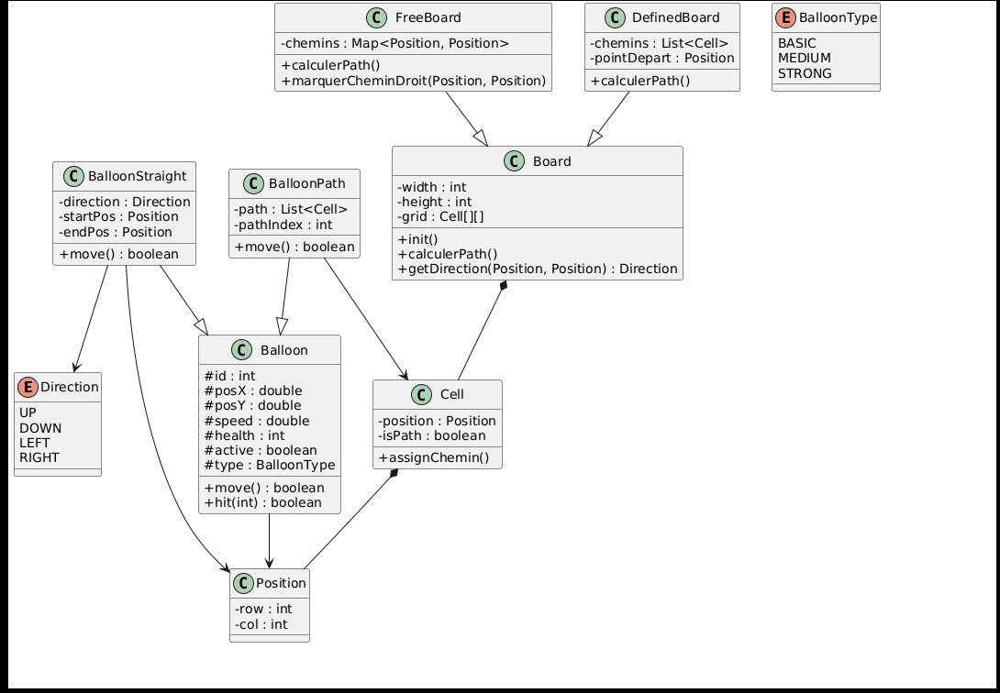
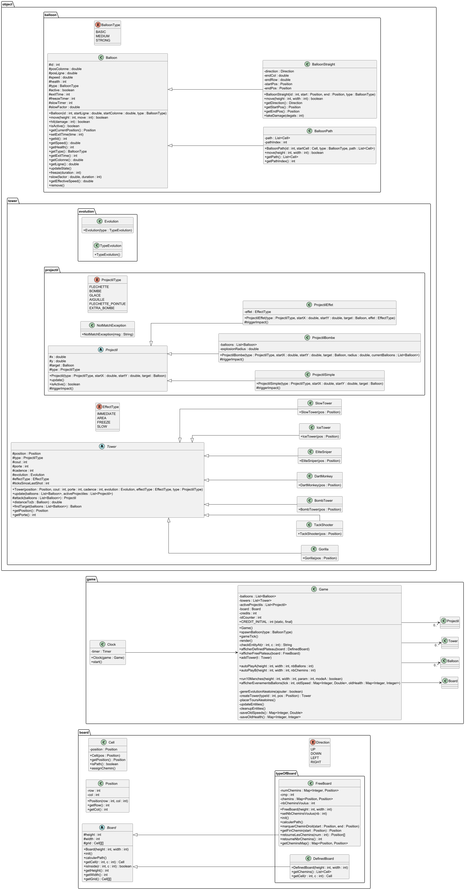

# l2s4-projet-2026

Vous devez *forker* ce projet dans votre espace de travail Gitlab (bouton `Fork`) et vidéo sur le [portail](https://www.fil.univ-lille.fr/portail/index.php?dipl=L&sem=S4&ue=Projet&label=Documents)
Un unique fork doit être réalisé par équipe.

Une fois cela réalisé, supprimer ces premières lignes et remplir les noms des membres de votre équipe.
N'oubliez pas d'ajouter les autres membres de votre équipe aux membres du projet, ainsi que votre enseignant·e (statut Maintainer).

# Equipe 5

- Son Tung DO
- sabine boukais
- ines agueniou
- yanni moutchou

# Sujet

[Le sujet 2026](https://www.fil.univ-lille.fr/~varre/portail/l2s4-projet/sujet2026.pdf)

# Livrables

Les paragraphes concernant les livrables doivent être remplis avant la date de rendu du livrable. A chaque fois on décrira l'état du projet par rapport aux objectifs du livrable. Il est attendu un texte de plusieurs lignes qui explique la modélisation choisie, et/ou les algorithmes choisis et/ou les modifications apportées à la modélisation du livrable précédent.

Un lien vers une image de l'UML doit être fourni (une photo d'un diagramme UML fait à la main est suffisant).

## Livrable 1

### Atteinte des objectifs

Le projet remplit actuellement les objectifs du premier livrable, à savoir la mise en place d'un système de plateau capable de générer deux types de structures de jeu distinctes. Deux types de plateaux ont été créés : le FreeBoard, où les chemins sont des lignes droites allant d’un bord à l’autre, et le DefinedBoard, où un chemin est généré de manière aléatoire en utilisant une logique de voisins pour éviter les boucles et faire en sorte que chaque cellule ne soit utilisée qu’une seule fois.

Chaque cellule est représentée par un objet Cell, qui contient sa position et indique si elle fait partie du chemin. Le plateau est représenté par une classe abstraite Board, qui contient la grille de cellules ainsi que des méthodes communes pour accéder aux cellules, vérifier les limites et manipuler les chemins. Cette abstraction permet de centraliser les fonctionnalités partagées et de faciliter l’extension : de nouveaux types de plateaux peuvent être créés en héritant de Board et en implémentant leurs propres règles de génération de chemins.

Pour FreeBoard, un algorithme simple parcourt les bords du plateau pour créer des chemins droits, en s’assurant que le départ et l’arrivée sont toujours sur un bord. Les positions déjà utilisées et leurs voisins sont bloqués pour éviter que les chemins se chevauchent.

Pour DefinedBoard, un algorithme aléatoire génère un chemin “serpent” : à chaque étape, la cellule suivante est choisie parmi les voisins disponibles, en évitant de revenir en arrière ou de dépasser les bords. Une longueur minimale est imposée pour éviter que le chemin ne se termine trop vite. Cela garantit un chemin unique et continu sur le plateau.

**Difficultés rencontrées** : il a été compliqué de trouver le code exact pour générer correctement le chemin aléatoire. Au début, des bugs apparaissaient souvent, comme des chemins très courts allant de deux cases seulement (départ et fin), ou des chemins qui se terminaient trop vite. Il a fallu ajuster l’algorithme et ajouter des vérifications pour garantir une longueur minimale et un chemin continu sans chevauchement.

**Commande pour compiler toutes les classes** : javac -d classes src/**/*.java

**Commande pour executer DefinedBoardMain (Livrable1a)** :  java -cp classes board.Livrable1a 11 5 (précisez la hauteur et la largeur)

**Commande pour executer FreeBoardMain (Livrable1b)** : java -cp classes board.Livrable1b 11 5 1 (précisez la hauteur et la largeur et le nombre de chemins)

**Commande pour la compilation des tests** : javac -cp junit-console.jar:classes -d classes test/board/*.java

**Commande pour executer les tests** : java -jar junit-console.jar -cp classes --scan-class-path

**Création JAR pour DefinedBoardMain** : jar cvfe livrable1a.jar board.Livrable1a -C classes .

**Exécution** : java -jar livrable1a.jar (précisez la hauteur et la largeur)

**Création JAR pour FreeBoardMain** : jar cvfe livrable1b.jar board.Livrable1b -C classes . 

**Exécution** : java -jar livrable1b.jar (précisez la hauteur et la largeur et le nombre de chemins)

### Difficultés restant à résoudre

Pour le moment, toutes les fonctionnalités du livrable 1 fonctionnent correctement.

## Livrable 2

### Atteinte des objectifs
Le projet remplit actuellement les objectifs du deuxième livrable, à savoir la création des ballons et la gestion de leur progression sur le plateau en fonction du temps.

Les ballons sont représentés par une hiérarchie de classes utilisant l'héritage : une classe mere balloon et deux sous classes BalloonPath utilisée pour DefinedBoard et BalloonStraight utilisée pour FreeBoard, grace a la methode move():

**BalloonPath.move()** : 
- Récupérer la cellule cible actuelle dans le chemin
- Calculer la distance jusqu'au centre de cette cellule
- Si distance ≤ vitesse : atteindre la cellule et passer à la suivante
- Sinon : avancer de "vitesse" unités vers la cible
- Si fin du chemin : marquer comme inactif

**BalloonStraight.move()** :

- Avancer de "vitesse" unités dans la direction (UP/DOWN/LEFT/RIGHT)
- Vérifier si la position finale est atteinte
- Si oui : marquer comme inactif

**Gestion du temps** 

- Un compteur currentTick s'incrémente à chaque itération
- À chaque tic, tous les ballons actifs appellent leur méthode move()
- Lorsqu'un ballon termine, son temps de sortie est enregistré
- La simulation continue tant qu'il reste au moins un ballon actif

Cette architecture permet l'extensibilité : si un nouveau type de plateau est créé, il suffira de créer une nouvelle classe héritant de Balloon et d'implémenter sa propre méthode move() adaptée au type de chemin.

**Difficultés rencontrées** : La principale difficulté a été de concevoir l'architecture des classes de ballons et de définir comment gérer leur mouvement de manière fluide avec des vitesses différentes. La synchronisation des ballons et la détection précise de leur sortie du chemin ont nécessité plusieurs ajustements pour fonctionner correctement.

**Commande pour compiler toutes les classes** : javac -d classes src/board/\*.java src/object/balloon/\*.java

**Commande pour executer (Livrable2a)** :  java -cp classes board.Livrable2a (précisez la hauteur et la largeur et nombres de ballons)

**Commande pour executer FreeBoardMain (Livrable2b)** : java -cp classes board.Livrable2b (précisez la hauteur et la largeur et le nombre de chemins)

**Commande pour la compilation des tests** : javac -cp junit-console.jar:classes -d classes test/board/\*.java test/object/balloon/\*.java

**Commande pour executer les tests** : java -jar junit-console.jar -cp classes --scan-class-path

**Création JAR pour Livrable2a** : jar cvfe livrable2a.jar board.Livrable2a -C classes .

**Exécution** : java -jar livrable2a.jar (précisez la hauteur et la largeur et nombres de ballons)

**Création JAR pour livrable2b** : jar cvfe livrable2b.jar board.Livrable2b -C classes .

**Exécution** : java -jar livrable2b.jar (précisez la hauteur et la largeur et le nombre de chemins)

### Difficultés restant à résoudre

Pour le moment, toutes les fonctionnalités du livrable 2 fonctionnent correctement.

## Livrable 3

### Atteinte des objectifs
Création des tours et gestion des tirs, intégration dans la gestion du temps

Les tours sont gérées par une hiérarchie de classes s'appuyant sur une classe mère abstraite Tower. Cette classe définit le comportement global des défenses grâce aux méthodes suivantes :

**Tower.findTarget() :**

- Parcourir la liste des ballons présents sur le plateau.
- Vérifier si un ballon est actif et situé dans le rayon de portée (porte) de la tour.
- Retourner le premier ballon valide comme cible.

**Tower.attack() :**

- Récupérer une cible via findTarget().
- Déterminer le type d'attaque selon l'effet de la tour (EffectType).
- Soit infliger des dégâts immédiats au ballon, soit générer un projectile 

**La classe Game :**
Elle coordonne l'ensemble des entités et assure la progression automatique du jeu grâce à deux types de méthodes :

**La gestion du temps (gameTick) :**
Orchestrer l'ordre des actions à chaque tic d'horloge : d'abord le déplacement des ballons, puis l'attaque des tours

**La classe MainTest:**
- Ca permet de jouer comme un jeu normal : il permet de choisir quelle action on veut lancer ( jouer, placer un tower ou terminer le jeu ), choisir quelle type de tower a placer et la position a placer, et permet aussi de generer le nombre de ballon qui nous attaque.

**L'automatisation (autoPlayA et autoPlayB) :**
- autoPlayA (DefinedBoard) : Initialise un plateau avec un chemin fixe, place aléatoirement des tours  hors du chemin, et génère la vague de ballons demandée.
- autoPlayB (FreeBoard) : Initialise un plateau libre, génère plusieurs chemins rectilignes, place les tours aléatoirement et crée un ballon par chemin.
Ces méthodes permettent de simuler une partie complète sans intervention manuelle, en affichant les événements (ballon détruit, sorti ou ralenti) directement dans la console jusqu'à la fin du round.

**Compilation :** make classes

**Compilation des tests :** make tests

**Lancer les tests :** make runtests

**Création des Livrables :** make jar

**Exécution avec arguments :**

- Exécuter le Livrable 3a : java -jar livrable3a.jar (précisez la hauteur et la largeur et le nombre de ballons)

- Exécuter le Livrable 3b : java -jar livrable3b.jar (précisez la hauteur et la largeur et le nombre de chemins)

**Nettoyage :** make clean

### Difficultés restant à résoudre

## Livrable 4

### Atteinte des objectifs
Le jeu se déroule en 10 manches successives. Pour les manches 1 à 5, une évolution est appliquée à chaque type de tour si cela est possible. Pour les manches 6 à 10, une évolution est supprimée de chaque type de tour si elles en possèdent. Les évolutions sont choisies aléatoirement parmi celles disponibles. L'affichage indique le numéro de manche ainsi que les évolutions appliquées ou supprimées.

**`run10Manches(int height, int width, int param, boolean modeA)`**
Orchestre les 10 manches du jeu. Pour les manches 1 à 5, appelle `gererEvolutionAleatoire(true)` pour appliquer une évolution à chaque type de tour. Pour les manches 6 à 10, appelle `gererEvolutionAleatoire(false)` pour en supprimer une. À chaque manche, appelle `autoPlayA` ou `autoPlayB` selon le mode choisi, puis vide la liste des ballons et projectiles actifs.

**`gererEvolutionAleatoire(boolean ajouter)`**
Parcourt toutes les tours du plateau en évitant les doublons grâce à un ensemble de symboles déjà traités. Si `ajouter` est vrai, choisit aléatoirement une évolution disponible parmi celles non encore appliquées et l'applique à la tour. Si `ajouter` est faux, choisit aléatoirement une évolution possédée par la tour et la supprime. Affiche l'évolution ajoutée ou retirée pour chaque tour.

**`afficherEvenementsBallons(int tick, Map oldSpeed, Map oldHealth)`**
Compare l'état des ballons avant et après chaque tick pour détecter et afficher les événements : TOUCHE, DETRUIT, SORTI, RALENTI, ARRETE et REDEMARRE. N'affiche que les événements qui se produisent réellement, sans afficher la position de tous les ballons.

**`createTower(int typeId, Position pos)`**
Crée et retourne une tour en fonction d'un identifiant de type (1 à 7) et d'une position. Permet de centraliser la création des tours et d'éviter la duplication de code dans `placerToursAleatoires`.

### Difficultés rencontrées

La principale difficulté a été de gérer les évolutions sans doublons, puisque deux tours de chaque type sont présentes sur le plateau. Il a fallu utiliser un ensemble de symboles déjà traités pour éviter d'appliquer deux fois la même évolution sur le même type de tour. Il a également fallu s'assurer que les évolutions choisies aléatoirement ne soient pas déjà appliquées sur la tour concernée.

La gestion de la boucle de jeu a également posé des problèmes. En effet, il a fallu sauvegarder l'état des ballons avant chaque tick pour pouvoir détecter les changements de vitesse et de santé après le tick. Sans cette sauvegarde, il était impossible de savoir si un ballon avait été touché, ralenti ou arrêté durant le tick en cours. Nous avons donc introduit les méthodes `saveOldSpeeds` et `saveOldHealth` pour capturer l'état avant chaque tick et `afficherEvenementsBallons` pour comparer et afficher uniquement les événements pertinents.

**Compilation :** make 

**Compilation des tests :** make tests

**Lancer les tests :** make runtests

**Création des Livrables :** make jar

**Exécution avec arguments :**

- Exécuter le Livrable 4a : java -jar livrable4a.jar (précisez la hauteur et la largeur et le nombre de ballons)

- Exécuter le Livrable 4b : java -jar livrable4b.jar (précisez la hauteur et la largeur et le nombre de chemins)

### Difficultés restant à résoudre

Notre code présente beaucoup de duplication, notamment dans la gestion de la boucle principale du jeu, ce qui le rend difficile à maintenir. De plus, certaines parties ne respectent pas pleinement les principes de la programmation orientée objet. Il sera nécessaire de réorganiser et repenser notre architecture, notamment en déplaçant certaines responsabilités vers les bonnes classes, en optimisant le code existant. Ces améliorations permettront également une meilleure extensibilité du projet pour les livrables suivants.

## Livrable 5

### Atteinte des objectifs

### Difficultés restant à résoudre

## Livrable 6

### Atteinte des objectifs

### Difficultés restant à résoudre

# Journal de bord

Le journal de bord doit être rempli à la fin de chaque séance encadrée, et **avant** de quitter la salle. 

Pour chaque semaine on y trouvera :
- ce qui a été réalisé, les difficultés rencontrées et comment elles ont été surmontées (on attend du contenu, pas uniquement une phrase du type "tous les objectifs ont été atteints")
- la liste des objectifs à réaliser d'ici à la prochaine séance encadrée

## Semaine 1

### Ce qui a été réalisé
pour l'object Board  peut etre une classe abstract , il ya deux sous classes  , une avec un chemin precis  ,
 défini pour la trajectoire des ballons, on va definir le debut et la fin du chemin nous meme  , 
on commence par la case debut on a le droit de choisir entre  3 cases voisines (inspiration DSI  Chaque tuile
du joueur a donc nécessairement 4 tuiles voisines (ou emplacements voisins)), sans la tuile ou le chemin est deja passe 
avec une fonction random , et a chaque fois que le tuile de chemin est cree ( on a choisi une case ), on oublie la colonne d'avant
et donc peut importe le nombre de cases de notre board ca va nous cree un chemin. 
pour deuxieme mode on choisi dabord le nombre de ballons qu'on va repartir en deux groupes , des ballons verticale ou horizontale ,puis on va 
choisir les chemins de maniere random , qui va choirir la case de debut pour chauque ballon , et la on va choisir le cote aussi de la meme façon 
car le ballon il peut sortir des deux cote 
pour le horloge , on fait avec une fonction comme thrad.sleep, et a chaque toc d'orloge on definie la vitesse du ballon ,
pour se deplacer d'une case a une autre on fait en sorte que chaque ballon prenne un temps x pour avancer a lautre case 

### Difficultés rencontrées
le chemin, le clock 
### Objectifs pour la semaine et répartition du travail par membre
diagramme uml complet, algo des chemins 
pour la repartion du travail on a pas eu le temps de discuter on a creer un groupe pour justement en discuter 
## Semaine 2

### Ce qui a été réalisé
Diagramme UML presque complet des Boards, et d'autres classes dont on aura besoin. L'algo des chemins. Pour le 1 er Board ,
 on choisi pas cas de la fin, et pour le deuxieme Board on va generer des chemins qui vont a toutes les directions , pas seulement de gauche a droite 
### Difficultés rencontrées
 le temps, pour synchroniser les ballons et les tours
### Objectifs pour la semaine et répartition du travail par membre
finir le diagramme UML, pseudo code des chemins , finaliser le premier livrable  
## Semaine 3

### Ce qui a été réalisé
on a finalisé le diagramme uml pour le board (sous reserve de modifications) on reste sur la meme idée d'une classe abstraite Board et deux sous classes DefinedBoard et FreeBoard 
ce qui nous permettra de créer des extensions de plateaux
pour le DefinedBoard donc le plateau avec un chemin definie notre algo choisi lui meme aleatoirement la case du debut de n'importe quel bord 
ensuite pour la construction du chemin il choisit une de ses cases voisines, la condition d'arret est : si on touche le bord n'importe lequel 
le chemin est fini donc le chemin ne peut pas etre sur les bords apart pour le debut et la fin 
pour le FreeBoard donc le plateau avec un chemin non precis pour le moment on a commencer avec un pseudo code donc c'est la case du debut choisi aleatoirement
qui decide de la trajectoire du chemin par exemple si elle est sur le bord d'en haut le chemin va tout droit vers le board du bas, si ça commence a gauche ça va vers la droite et inversement 
on a aussi implementé des classe Cell et position pour mieux gérer les cases 
### Difficultés rencontrées
le code exact pour l'algo des deux chemins 
### Objectifs pour la semaine et répartition du travail par membre
finir le livrable 1 donc : la creation des deux types de plateaux et le calcul des chemins
pour le repartion on mettra a jour le readme durant la semaine du travail de chaque membre

## Semaine 4

### Ce qui a été réalisé
la suite du diagramme uml avec une classe ballon, round (pour gérer les manches), un enum Level pour les niveaux de resistance et une classe horloge pour gérer les tic d'horloge (pour l'algo exact on l'a pas encore fini)
### Difficultés rencontrées
gerer les tic d'horloge et la gestion du deplacement des ballons sur les plateaux
### Objectifs pour la semaine et répartition du travail par membre
finir le livrable 2 et entamer le livrable 3 
## Semaine 5

### Ce qui a été réalisé
pseudo diagramme pour le livrable 3 
### Difficultés rencontrées
gestion du temps 
### Objectifs pour la semaine et répartition du travail par membre
revoir la structure des classes plus precisement reduire le code des main et leurs packetages 
## Semaine 6

### Ce qui a été réalisé
livrable 3 
### Difficultés rencontrées

### Objectifs pour la semaine et répartition du travail par membre

## Semaine 7
correction du makefile, et des classes de tests, discussion sur le livrable 4
### Ce qui a été réalisé

### Difficultés rencontrées

### Objectifs pour la semaine et répartition du travail par membre
avancer au maximum dans le livrable 4 : cree la classe evolution avec les tests, ajouter les evolution dans le game 

## Semaine 8

### Ce qui a été réalisé
classe Evolution et evolutionType pour gerer les evolutions avec les classes de tests

### Difficultés rencontrées

### Objectifs pour la semaine et répartition du travail par membre
finaliser le livrable 4 

## Semaine 9
Discussion générale

Nous avons soulevé des problèmes conceptuels, notamment par rapport à l’approche adoptée lors des commits précédents, qui se rapproche plus du fonctionnel que de la conception orientée objet.

Il est nécessaire de :

¤  Détailer le README.

¤  Gérer l’affichage des plateaux (tout ne doit pas être géré dans la classe   Game).

¤  Pour les ballons, il faut avoir une seule classe Ballon et gérer leurs comportements ailleurs.

¤  Découper les méthodes play(Board b) pour éviter la duplication de code.

¤  Prévoir un exemple de chooseTower pour choisir les tours soit manuellement, soit aléatoirement.

¤  Supprimer les méthodes séparées de play et centraliser leur gestion dans play(Board b).

¤  Gérer également la duplication de code dans les classes Projectil.

### Ce qui a été réalisé
Nous avons travaillé sur le début du livrable 5, en mettant en place la structure générale. Nous essayons de gérer au mieux la duplication de code, sans toutefois impacter le fonctionnement du livrable 4.

### Difficultés rencontrées

¤  Duplication de code dans plusieurs classes.

¤  Suivi d’une approche orientée objet.
### Objectifs pour la semaine et répartition du travail par membre

 Améliorer au mieux la duplication de code.

Finaliser le livrable 4.

Gérer les actions du joueur.
## Semaine 10

### Ce qui a été réalisé

### Difficultés rencontrées

### Objectifs pour la semaine et répartition du travail par membre

## Semaine 11

### Ce qui a été réalisé

### Difficultés rencontrées

### Objectifs pour la semaine et répartition du travail par membre

## Semaine 12

### Ce qui a été réalisé

### Difficultés rencontrées

### Objectifs pour finaliser le projet et répartition du travail par membre